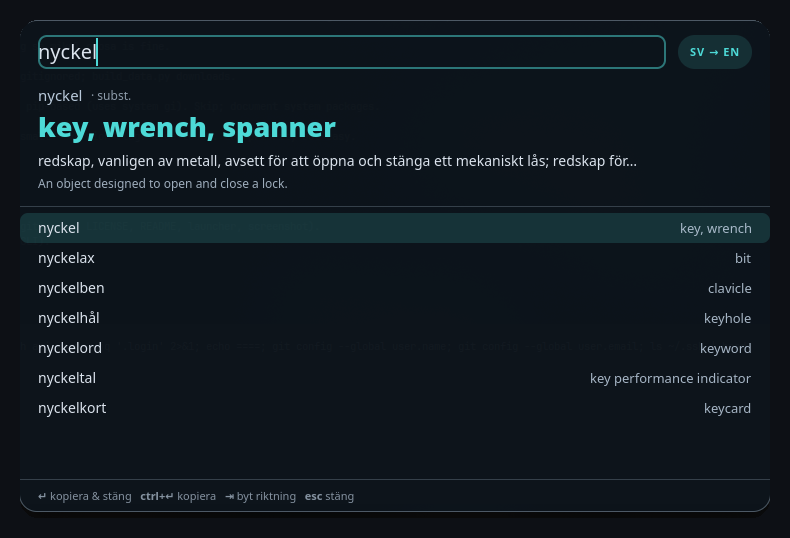

# glosa — a tiny Swedish ↔ English lookup popup

Hit a hotkey, type (badly), get the word. **glosa** is a floating translator for
Wayland desktops: it opens instantly, tolerates typos with fuzzy suggestions,
works offline for translations, and puts the best translation on your clipboard
with one keypress.



*(UI strings are Swedish — the tool is built for Swedish speakers learning
English and vice versa. They're all in `glosa.py` if you want to translate them.)*

## Features

- **Instant popup** — a GTK4 `wlr-layer-shell` overlay anchored top-centre of the
  focused output. No window borders, no taskbar entry, no focus stealing games
  (it closes when it loses focus).
- **Typo-tolerant suggestions** — prefix, edit-distance and substring matching
  over ~45k Swedish / ~40k English words, ranked by frequency. Every suggestion
  row previews its translation so you can spot the right word while typing.
- **Translations work offline** — EN→SV is a direct dictionary lookup, SV→EN is a
  reverse index over the same data. 0–15 ms per word.
- **Short explanations** — the first definition from Swedish Wiktionary
  (cached), plus the English definition from the offline dictionary.
- **One-key copy** — `Enter` copies the primary translation and closes.
- **Direction auto-detection** — type a Swedish word and it goes SV→EN; press
  `Tab` to flip.
- **No accounts, no API keys, no telemetry.** The only network call is the
  Wiktionary gloss, and it's cached for 30 days.

## Requirements

- Linux with Wayland (X11 works too — the popup then opens as a normal window)
- GTK 4, Python 3.9+, PyGObject
- `gtk4-layer-shell` (for the overlay behaviour)
- `notify-send` (optional, for the copy confirmation)
- ~10 MB disk for the dictionary

```bash
# Arch / CachyOS
sudo pacman -S python-gobject gtk4 gtk4-layer-shell libnotify

# Debian / Ubuntu (package names may differ slightly)
sudo apt install python3-gi gir1.2-gtk-4.0 libgtk4-layer-shell0 libnotify-bin

# Fedora
sudo dnf install python3-gobject gtk4 gtk4-layer-shell libnotify
```

## Install

```bash
git clone https://github.com/mikul-/glosa.git
cd glosa

# 1. build the offline dictionary (~2 s, downloads ~4 MB)
python3 build_data.py

# 2. put the launcher on your PATH
ln -s "$PWD/glosa" ~/.local/bin/glosa    # or copy it
```

Bind `glosa` to a key in your compositor:

```ini
# mango (~/.config/mango/config.conf)
bind=SUPER,T,spawn,~/.local/bin/glosa

# Hyprland (~/.config/hypr/hyprland.conf)
bind = SUPER, T, exec, ~/.local/bin/glosa

# sway (~/.config/sway/config)
bindsym $mod+t exec ~/.local/bin/glosa
```

GNOME/KDE: add a custom shortcut that runs `~/.local/bin/glosa`.

## Usage

| Key | Action |
|---|---|
| type | fuzzy suggestions + live translation of the top hit |
| `↑` `↓` | pick another suggestion |
| `Enter` | copy the primary translation and close |
| `Ctrl+Enter` | copy, keep the popup open |
| `Tab` | flip SV→EN / EN→SV |
| `Esc` | close |

The popup hides when it loses focus and the process exits after 10 idle
minutes, so repeat lookups stay instant without a permanent daemon.

CLI (useful for scripts and for checking the data):

```bash
glosa hus             # offline lookup, prints to stdout
glosa -r nyckelpiga   # + the Swedish Wiktionary gloss (network, cached)
```

## How it works

**Dictionary** — `build_data.py` downloads the FreeDict `eng-swe` dictionary
(WikDict's build of Wiktionary, ~44k headwords / 52k senses) and the
FrequencyWords 50k Swedish/English lists, then writes a ~10 MB SQLite file:

| table | contents |
|---|---|
| `entries` | one row per sense: headword, part of speech, English definition |
| `trans` | sense → Swedish translation(s) |
| `wiki` | cached Wiktionary glosses (30-day TTL) |

SV→EN is the same data read backwards (`WHERE trans.t = ?`), ranked by how
central the Swedish word is to each English headword plus English frequency.

**Suggestions** — the word lists are loaded once per language and matched in
tiers: exact → prefix (binary search) → `difflib` edit distance → substring
(compounds like `flaskhals`). Each hit is ranked by frequency, then length.

**Glosses** — the Swedish definition comes from `sv.wiktionary.org`'s API
(wikitext parsed locally, cached in SQLite). If you're offline you still get
translations and English definitions; only the Swedish one-liner is missing.

**Theming** — colours are read from `~/.config/matugen/colors.json` when it
exists (regenerated by [matugen](https://github.com/InioX/matugen)); otherwise a
neutral dark palette is used.

## Rebuilding the dictionary

```bash
python3 build_data.py
```

It resolves the newest FreeDict `eng-swe` release automatically; downloads are
cached in `.cache/` and can be deleted at any time.

## Troubleshooting

**The popup appears as a normal window / prints “Failed to initialize layer
surface”.** `gtk4-layer-shell` must be loaded before libwayland. The launcher
sets `LD_PRELOAD` for it automatically; if you run `glosa.py` directly, do:

```bash
LD_PRELOAD=/usr/lib/libgtk4-layer-shell.so.0 python3 glosa.py
```

**No Swedish explanation.** That part needs network access to
`sv.wiktionary.org`; translations do not.

**Nothing found.** The bundled vocabulary is the dictionary plus the 50k
frequency lists. Rare words may be missing entirely — the popup will tell you.

## Data & licence

- Code: MIT (see [LICENSE](LICENSE)).
- Dictionary data: [FreeDict eng-swe](https://freedict.org/) by Karl Bartel,
  derived from Wiktionary via WikDict — **CC BY-SA 3.0**. The data is downloaded
  at build time and is not part of this repository.
- Word frequency lists: [FrequencyWords](https://github.com/hermitdave/FrequencyWords)
  (MIT), from the OpenSubtitles corpus.
- Glosses: [sv.wiktionary.org](https://sv.wiktionary.org) — CC BY-SA 4.0.

If you redistribute a built `data/glosa.db`, keep the CC BY-SA attribution.
